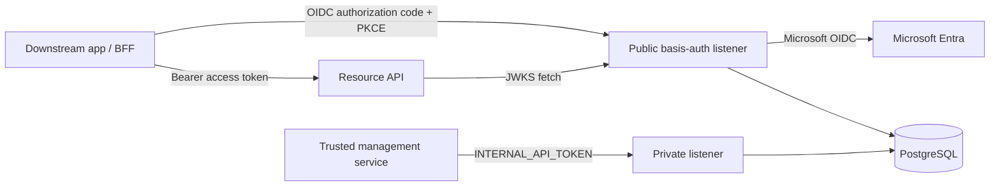
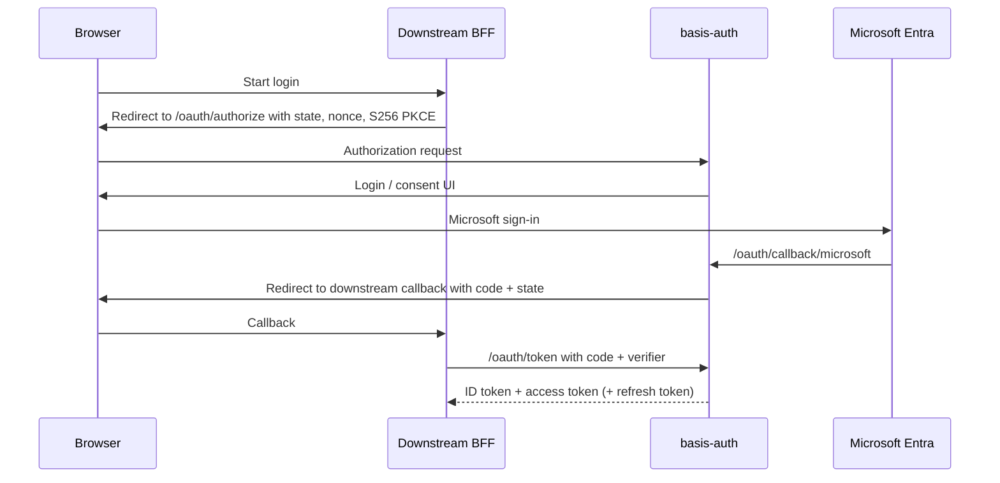

# Architecture

basis-auth is a PostgreSQL-backed OpenID Connect provider. One Node.js process
serves two HTTP listeners: the public protocol and login UI, plus a private
internal API. The management portal UI is a separate integration and is not
included in this repository.

## Components

The private listener runs in the same service process and uses the same database
connection. Its default bind is `127.0.0.1:3001`; the public listener defaults
to port `3000`. The management integration presents an end-user access token
for delegated management operations.

## Authorization flow

Each authorization request selects exactly one resource audience. A configured
client with one resource may omit `resource`; otherwise the request must name
one of the client's registered resources.

## Token lifecycle

- Authorization requests expire after 10 minutes.
- Authorization codes are single-use and expire after 60 seconds.
- ID tokens are RS256 JWTs with a 10-minute lifetime.
- Access tokens are RS256 JWTs with `typ=at+jwt`. Their lifetime defaults to
  10 minutes and is configurable with `ACCESS_TOKEN_LIFETIME_MS`.
- Refresh tokens are opaque, stored as hashes, expire after 30 days, and rotate
  on use. Reusing a consumed or expired token revokes the token family.
- Confidential clients can also use `client_credentials`. These tokens identify
  the client, contain no user permissions, and have no refresh token or ID token.

The access token `aud` is its selected resource audience. Its permissions are
specific to the client that issued it. The `permissions` array is present in
access tokens even when empty; it is not an OIDC request scope.

## Persistence and runtime behavior

The database stores upstream user identities, mapped email suffixes and
organizations, client and resource registrations, application-scoped permission
definitions and grants, sessions, authorization requests and codes, refresh
token families, and remembered consent.

- Client metadata uses a process-local LRU cache with a 60-second TTL. Only
  successful lookups are cached, so a newly inserted client is loaded on the
  next request and client edits become visible within the TTL.
- Disabled clients are rejected with `14002`; missing clients return `14001`.
- `GET /health` and the startup log report the package version, optional commit,
  start time, environment, process ID, bound port, and sanitized database host,
  port, and name.
- Resource-server rows are checked during authorization and token issuance.
- Discovery metadata is cached for 300 seconds by HTTP clients; JWKS advertises
  `max-age=300` and `stale-while-revalidate=300`.
- Rate limits are process-local: 120 requests per minute per IP and route on
  selected public endpoints.
- SSO sessions use a 12-hour idle timeout and 30-day absolute cap by default.
  `SESSION_IDLE_TIMEOUT_MS` and `SESSION_ABSOLUTE_MAX_MS` can change those limits.

`GET /api/picture/:userId` serves stored profile pictures without an SSO
session. It returns 404 when no picture is stored, uses a five-minute public
cache, and sets `Cross-Origin-Resource-Policy: same-site`.
