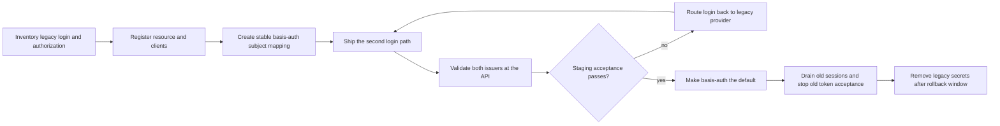
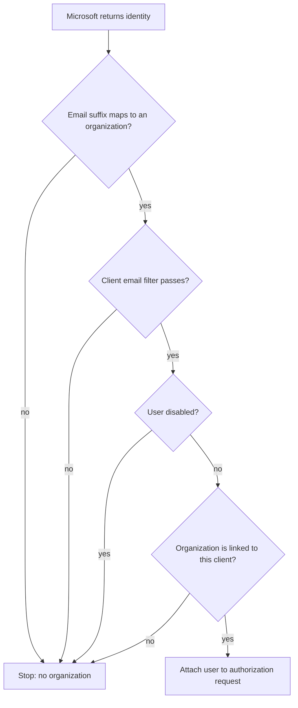

# Porting an application to basis-auth

This guide covers a new integration and a careful migration from an existing
login system. It is written against the current implementation in
`src/app.ts`, `src/config.ts`, `src/oauth/`, `src/database/`,
`src/internal/`, and `examples/hono-resource-server/`.

## 1. Implementation contract

basis-auth authenticates people through Microsoft Entra. It then issues
OpenID Connect tokens to registered applications. Each access token is for
exactly one registered resource audience.

| Artifact | Current behavior |
| --- | --- |
| Authorization request | Expires after 10 minutes; requires `openid`, state, nonce, and S256 PKCE. |
| Authorization code | Opaque, single-use, and valid for 60 seconds. |
| ID token | RS256 JWT, audience is the client ID, lifetime is 10 minutes. |
| User access token | RS256 JWT with `typ=at+jwt`, audience is the requested resource, and default lifetime 10 minutes. |
| Refresh token | Opaque, rotates on use, and expires 30 days after the original issue. It is issued only when `offline_access` was requested. |
| Client-credentials token | Confidential clients only. It represents the client and has no ID or refresh token. |

Set `ACCESS_TOKEN_LIFETIME_MS` to change the user and client access-token
lifetime. ID tokens remain 10 minutes. Refresh rotation keeps the original
family expiry; it does not extend the 30-day deadline.

A user ID token has `sub`, `iss`, `aud`, `iat`, `exp`, `nonce`,
`auth_time`, and `at_hash`. With `profile` it includes the user's name and a
picture URL. With `email` it includes the email address. The service does not
issue an `email_verified` claim.

A user access token has `sub`, `client_id`, `scope`, `permissions`, `gty`,
`jti`, `iat`, `exp`, `iss`, and `aud`. `permissions` is an array for the
issuing client, including an empty array when the user has no grants. It is
not a special OAuth scope. The ID token and UserInfo response do not contain
the permission array.

The user key is the basis-auth `sub`, a UUID that stays stable for the same
stored Microsoft provider, issuer, and subject. Email is profile data and can
change. Do not use it as a durable foreign key.

## 2. Register a client and resource

Register one resource audience for each API that validates its own tokens.
The resource registry defines which API scopes exist:

```json
[
  {
    "audience": "urn:example:api",
    "name": "Example API",
    "scopes": ["projects.read", "projects.write"]
  }
]
```

Register a client with access to that resource. A confidential BFF keeps a
secret on the server:

```json
[
  {
    "clientId": "example-web",
    "name": "Example Web",
    "clientSecret": "replace-with-a-random-secret-of-at-least-16-chars",
    "redirectUris": ["https://app.example.org/oauth/callback"],
    "public": false,
    "resources": ["urn:example:api"],
    "scopes": ["projects.read", "projects.write"],
    "resourceScopes": {
      "urn:example:api": ["projects.read", "projects.write"]
    },
    "permissions": {
      "projects.member": "May use member features"
    },
    "defaultPermissions": ["projects.member"],
    "requireConsent": true,
    "organizationIds": ["cbc6e1e2-a6bb-4002-bbdc-6da892a051a7"],
    "filterMode": null,
    "filterContent": []
  }
]
```

`OIDC_RESOURCES_JSON` and `OIDC_CLIENTS_JSON` are arrays of these records.
For each resource, the client may request only scopes allowed by both the
resource and that client's `resourceScopes`. If omitted, `resourceScopes`
uses the client `scopes` list for each resource.

The built-in identity scopes are `openid`, `profile`, `email`, and
`offline_access`. Custom scopes such as `projects.read` must be registered
on the resource and allowed for the client. `permissions` is not a built-in
scope; do not request it unless you registered that custom scope.

The `permissions` object defines this client's user-permission catalog.
`defaultPermissions` must name entries in that catalog. These grants are
separate from scopes: a resource API can require both a scope and a user
permission.

Default permissions are copied when a user first completes an authorization
code flow for that client. Changing defaults does not retroactively grant
them to users already affiliated with the client. The catalog is also used
to validate grants and remove stale grants at the user's next login.

### Registration workflow

For direct database registration, set both JSON arrays before startup.
Startup upserts configured clients and resources. Removing a JSON entry does
not delete the database row.

For live database registration, use the CLI:

```bash
bun run clients
bun run clients:add
```

The interactive flow asks for client type, redirect URIs, resources, scopes,
consent, organizations, filters, and permission definitions. It can create a
resource audience while saving a client. Generated `sk-...` secrets are
printed once; the database stores only a scrypt hash. New registrations are
available immediately. Existing client metadata may take up to 60 seconds to
refresh from cache.

Bootstrap grants use this shape:

```json
[
  {
    "email": "admin@example.org",
    "applicationId": "example-web",
    "permissions": ["projects.member"]
  }
]
```

The grant is matched by normalized email when Microsoft signs the user in.
It is scoped to `applicationId` and inserted only if that grant is absent.
Define each permission in that client's catalog or it will be pruned during
the client's next login.

### Redirect URI rules

Normal redirect URIs must match exactly, including scheme, host, port, path,
and query. Prefer a separate client per environment so secrets and grants
remain isolated.

Public clients may register `http://localhost:*/auth/callback`. This matches
a concrete numeric localhost port such as
`http://localhost:49152/auth/callback`. Only the port is variable. The path
must match exactly; query strings and fragments are not supported. This
wildcard is rejected for confidential clients.

## 3. New application flow

### Request and token sequence

```mermaid
sequenceDiagram
    participant Browser
    participant BFF as Application BFF
    participant IdP as basis-auth
    participant Entra as Microsoft Entra
    participant API as Resource API
    Browser->>BFF: Start login
    BFF->>BFF: Store state, nonce, and PKCE verifier
    BFF-->>Browser: Redirect with resource and S256 challenge
    Browser->>IdP: GET /oauth/authorize
    IdP->>Entra: Authenticate user
    Entra-->>IdP: Microsoft identity
    IdP-->>Browser: Redirect with code and state
    Browser->>BFF: Callback
    BFF->>IdP: POST /oauth/token with code and verifier
    IdP-->>BFF: ID token and access token; optional refresh token
    BFF->>API: Bearer access token
    API-->>BFF: API response
```

Use a backend-for-frontend (BFF) when the app has a server. The BFF owns the
app session, client secret, PKCE verifier, and refresh token. The browser
never receives the client secret or refresh token.

### 3.1 Start login

Fetch `{issuer}/.well-known/openid-configuration` and use its endpoint values.
Cache discovery and JWKS for five minutes. Generate independent random
`state`, `nonce`, and a PKCE verifier. Store all three server-side with a
short expiry, keyed to the browser's pending login.

A verifier must be 43–128 characters from
`[A-Za-z0-9._~-]`. The challenge is the base64url SHA-256 digest of the
verifier. Send `code_challenge_method=S256`; `plain` is not accepted.

Redirect the browser to the authorization endpoint with:

```text
client_id=example-web
response_type=code
redirect_uri=https://app.example.org/oauth/callback
scope=openid profile email offline_access projects.read
resource=urn:example:api
state=<random-state>
nonce=<random-nonce>
code_challenge=<base64url-sha256-verifier>
code_challenge_method=S256
```

The provider requires `openid` and one resource audience. If the client has
exactly one resource, the `resource` parameter may be omitted. With multiple
resources it must be supplied. Requests for an unregistered resource or
scope fail; these are configuration errors, not retryable login failures.

### 3.2 Handle the callback

The browser returns to the registered redirect with `code` and `state`.
Compare state with the pending server-side login before exchanging the code.
If the callback contains `error=access_denied`, show a cancellation or
access-denied page. Do not retry automatically.

Authorization codes are valid for only 60 seconds. Exchange promptly from
your server:

```bash
curl -u 'example-web:CLIENT_SECRET' \
  -H 'Content-Type: application/x-www-form-urlencoded' \
  --data-urlencode 'grant_type=authorization_code' \
  --data-urlencode 'code=AUTHORIZATION_CODE' \
  --data-urlencode 'code_verifier=ORIGINAL_VERIFIER' \
  --data-urlencode 'redirect_uri=https://app.example.org/oauth/callback' \
  https://auth.example.org/oauth/token
```

The token request must include the matching verifier. Repeating
`redirect_uri` is optional; if sent, it must exactly equal the value in the
authorization request. A code can be consumed once.

For a confidential client, send HTTP Basic credentials. For a public client,
send `client_id` in the form body and no secret. Do not send a secret in the
body for authorization-code or refresh-token grants.

The token endpoint accepts form-encoded or JSON bodies. Its discovery
document advertises `client_secret_post`, but this implementation only
accepts a body secret for `client_credentials`. Use Basic authentication for
confidential authorization-code, refresh, and revocation requests.

A successful authorization-code response contains `access_token`,
`token_type=Bearer`, `expires_in`, and `scope`. It also contains `id_token`.
It contains `refresh_token` only if the request included `offline_access`.

### 3.3 Validate the ID token and create the app session

Use an OIDC/JWT library. Validate the signature with the discovery JWKS, exact
issuer, client-ID audience, RS256 algorithm, expiry, and nonce. Validate
`at_hash` if your library does not do that automatically.

Use the ID token `sub` as the stable external identity. Create or link the
local app user according to your account-linking policy. Then create a new
app-owned session cookie with `HttpOnly`, `Secure` in production, and
`SameSite=Lax`. Do not reuse or forward the `basis_sso` cookie.

Store the access token server-side. If the app needs refresh, encrypt the
refresh token at rest and serialize refresh operations per session. Delete
the pending state, nonce, and verifier after the callback completes.

The ID token's `picture` value is a URL at the provider's
`/api/picture/:userId` route. That route is public and returns a cached
picture when one exists. Do not assume it requires the user's SSO cookie.

### 3.4 Call your resource API

Send only the access token to the API:

```http
Authorization: Bearer <access_token>
```

The token audience must equal that API's registered resource audience. The
API should validate signature, algorithm, issuer, audience, expiry, token
type, and required claims before authorizing the request.

Use `/oauth/userinfo` only when the app intentionally needs profile claims.
It accepts GET or POST with a Bearer user access token. It returns claims
allowed by the token's scopes. Client-credentials tokens cannot call UserInfo.

### 3.5 Refresh and revoke

Refresh before the access token expires, leaving time for clock skew and
network retries. A refresh request uses the same confidential-client
authentication and sends `grant_type=refresh_token` plus the current token.

Every successful refresh returns a new refresh token and consumes the old
one. Persist the new token before another request can use the session. If a
consumed or expired token is reused, basis-auth revokes that whole family.
Treat `invalid_grant` as a reason to clear the refresh state and re-authenticate.

To revoke, POST the refresh token to `/oauth/revoke` using form encoding.
Then delete the app session and clear its cookie. Redirect to
`/oauth/logout` if the app should also end the shared basis-auth SSO session.
That endpoint does not sign the person out of Microsoft.

Confidential clients may use `client_credentials` for service-to-service
access. They must be registered to the resource and scopes they request.
The resulting token has `sub` and `client_id` set to the client ID,
`gty=client_credentials`, and an empty permissions array. It has no user
identity, ID token, or refresh token. Public clients cannot use this grant.

## 4. Port-in runbook

Keep the old login working until the new path and API authorization have
passed staging and production checks. Make the migration reversible at each
step.

### Port-in phases



### 4.1 Inventory the current system

Write down each current login, identity, and authorization dependency:

| Item | Record before changing code |
| --- | --- |
| Login methods | Password, MSAL, shared cookie, another IdP, service key, or combinations. |
| Callback and logout routes | Exact routes, allowed redirect origins, logout side effects. |
| User key | Database primary key, external subject, email use, and uniqueness rules. |
| Session behavior | Cookie name/domain, TTL, persistence, CSRF defenses, revocation. |
| API credentials | JWT issuers, audiences, signing keys, scopes, custom claims, key rotation. |
| Authorization | Roles, entitlements, tenant membership, and where each check occurs. |
| Operational dependencies | Password reset, account recovery, invitations, provisioning, audit needs. |

Classify each existing user as linkable to a Microsoft account, provisioned
only by an administrator, or unsupported. basis-auth does not store local
passwords or migrate password hashes.

### 4.2 Add a stable basis-auth identity mapping

Add a nullable unique column or a separate identity-link table to the
application database. Example column names are illustrative:

```sql
ALTER TABLE app_users ADD COLUMN basis_auth_sub uuid;
CREATE UNIQUE INDEX app_users_basis_auth_sub_unique
  ON app_users (basis_auth_sub)
  WHERE basis_auth_sub IS NOT NULL;
```

Keep the existing local primary key. Store the basis-auth `sub` beside it.
Do not replace local foreign keys with email addresses.

The stable basis-auth identity comes from Microsoft provider, issuer, and
subject. The email is profile data and may change. The service does not issue
`email_verified`, so do not silently link an existing account by email match
alone.

Use one of these explicit linking policies:

1. Require the user to sign in to the existing app account, then complete
   basis-auth login in the same protected linking flow.
2. Verify the account association with an administrator or another
   independently trusted process.
3. Create a new local app account under the app's normal provisioning rules.

Protect linking with state, CSRF defenses, and a uniqueness check. If a
basis-auth subject is already linked to another local account, stop and
resolve the conflict. Never auto-merge two accounts.

### 4.3 Register the staging and production clients

Create a resource for each API and register a client per environment. Use
separate secrets and callback URIs for staging and production. Keep each
callback exact and HTTPS in production.

Grants and defaults are scoped to the client ID. Separate staging and
production clients therefore have separate user permission grants. Decide
whether this is desired before assigning defaults.

Configure the client account restrictions deliberately:

- Set `organizationIds` to the Entra tenant IDs accepted for this client.
- Map each allowed email-domain suffix to the matching organization in the
  database.
- Use `filterMode=whitelist` for a closed pilot or `blacklist` for exclusions.
- Use `requireConsent=false` only for a first-party app whose registered
  scopes you operate.

A client with one organization uses that tenant's Microsoft authority. A
client with multiple organizations uses the Microsoft `/organizations`
authority, then the callback checks the user's mapped email organization
against the client's allowed organizations.

### 4.4 Add a second login path

Add a “Sign in with DevConnect” route without removing the old login. Create a
separate pending-login record containing state, nonce, verifier, expiry, and
the browser session key.

At callback, validate state before token exchange. Validate the ID token,
then link the returned `sub` using the policy from Section 4.2. Create the
same local session shape your app already uses. This lets existing route
authorization and application data continue to use the local user ID.

Do not put the verifier, client secret, access token, or refresh token in
browser-readable storage or URLs. The only token-like value returned through
the browser is the short-lived authorization code.

### 4.5 Map roles and permissions intentionally

Separate API capabilities from user entitlements:

- Register OAuth scopes such as `projects.read` on the resource server.
  Enforce these with API middleware such as `requireScopes`.
- Define user permissions in the client `permissions` catalog.
  Enforce these with `requirePermissions` or your own server checks.
- Keep app roles in your own database if they are not meant to be managed by
  basis-auth.
- Request only the scopes and permission data the app actually uses.

A grant such as `projects.member` belongs to one client. It does not grant
the same permission to another client. Access tokens carry the current
client's grants. Existing tokens are not rewritten when a grant changes.

If first-login defaults are appropriate, define both `permissions` and
`defaultPermissions` before inviting users. Existing users already recorded
in `user_applications` do not receive new defaults automatically.

Use `BOOTSTRAP_PERMISSION_GRANTS_JSON` only for explicit app-scoped bootstrap
grants. Its `applicationId` must be the client ID, and each grant must exist
in that client's permission catalog.

### 4.6 Migrate API authentication in parallel

Deploy API middleware that can validate old and new credentials temporarily.
Keep the acceptance rule explicit:

| Token kind | Temporary handling |
| --- | --- |
| Legacy access token | Validate with the existing issuer, audience, signature key, expiry, and legacy revocation rules. |
| basis-auth access token | Validate with the basis-auth JWKS, exact issuer, API audience, expiry, `typ=at+jwt`, and required claims. |

Never decide the issuer from an untrusted decoded token alone. Verify a
candidate against its configured trusted issuer and key set. Do not translate
foreign tokens into basis-auth tokens or accept ID tokens at an API.

Map API requests to the local user using the stored `basis_auth_sub`. Do not
search for the local user by email on every request. If the API needs immediate
revocation, add the trusted subject lookup described in Section 5.2.

### 4.7 Dual-run, observe, and rollback

Test in staging with representative users, roles, organizations, and account
filters. Track successful logins and token errors by client ID and error code.
Never log authorization codes, tokens, client secrets, PKCE verifiers, or raw
session cookies.

Keep the old authentication path and secret material until the new path has
passed the agreed observation period. Define a rollback switch that routes
new logins back to the old provider and leaves already linked subject mappings
intact.

During rollback, stop accepting basis-auth tokens at the API if the issuer or
key configuration is the problem. Do not convert tokens or sessions between
the providers. Users can authenticate again after the old path is restored.

### 4.8 Cut over and remove legacy credentials

When the new path is stable:

1. Make basis-auth the default login path.
2. Stop creating sessions through the old login.
3. Wait for or invalidate old-format app sessions using the app's own policy.
4. Remove legacy token verification after all old tokens have expired or been
   rejected.
5. Remove old IdP secrets and redirect URIs from app deployments.
6. Keep the subject-link records and support audit data needed to investigate
   account-link decisions.
7. Drop password hashes and reset-token columns only after recovery and
   rollback windows have closed.

Do not copy password hashes into basis-auth. Local password accounts and MFA
credentials are not supported by this implementation.

### 4.9 Notes by starting point

- **Password login:** replace password verification and reset flows with
  Microsoft sign-in. Preserve app-specific roles and records. Provide an
  account-linking or provisioning path for users without an accepted Microsoft
  account.
- **Direct MSAL:** move the Entra client registration and secret to basis-auth.
  Register each app callback with basis-auth. Keep tenant allow rules in the
  client organizations and email-domain mappings.
- **Shared monolith cookie:** give each app its own session. Use the basis-auth
  SSO session for shared login; do not share application cookies between apps.
- **Self-issued JWTs:** declare each API audience and its scopes as a resource.
  Update APIs to validate basis-auth JWKS, issuer, audience, token type, and
  app permissions. Retire old signing keys after the transition window.
- **Another IdP:** use the authorization-code + PKCE flow with basis-auth.
  The new `sub` namespace is different. Link identities explicitly; do not
  attempt to translate foreign sessions or tokens.

## 5. Resource API validation

The example middleware is in `examples/hono-resource-server/auth.ts`. It
fetches and caches JWKS, accepts RS256 with `typ=at+jwt`, checks issuer,
audience, expiry, and required access-token claims, then exposes
`requireScopes` and `requirePermissions`.

```ts
app.use("/api/*", basisAuth({
  issuer: process.env.BASIS_AUTH_ISSUER ?? "http://localhost:3000",
  audience: "urn:example:api"
}));

app.get(
  "/api/projects",
  requireScopes("projects.read"),
  requirePermissions("projects.member"),
  (c) => c.json({ userId: c.get("basisToken").sub, projects: [] })
);
```

The `projects.read` scope must exist on the resource and be allowed by the
client. The `projects.member` permission must be defined and granted for that
client. A valid user token may have no permissions; the middleware then
returns `403 insufficient_permissions`.

### 5.1 When local JWT validation is enough

Without an online subject lookup, the example API makes its decision from the
JWT. A permission change is visible after the current access token expires.
With the default access-token lifetime, that is normally within 10 minutes.

### 5.2 Enforce immediate user revocation

The example accepts a `loadTokenSubject` callback. The internal user route
requires `INTERNAL_API_TOKEN` and returns a `user` object with `disabled` and
`tokensValidAfter` fields.

Map that response to `{ disabled, tokensValidAfter }`. Reject a missing user,
disabled user, or a token whose `iat` is at or before the barrier. A network
failure should fail closed if immediate revocation is a requirement.

This check is for user tokens. Client-credentials tokens represent an
application and have no user subject state to load.

## 6. Operations and troubleshooting

### Account and organization gates



The sign-in callback checks several independent controls:

1. A client email whitelist or blacklist, compared against trimmed,
   lowercased email.
2. The user's email suffix must map to an organization.
3. That organization must be linked to the requesting client.
4. The user must not be disabled.

The default migrations map `basischina.com` and `basis-global.com` to the
default organization. A different domain needs an explicit suffix mapping.
Suffix matching uses the mapped email domain; it is not an arbitrary wildcard.

A whitelist allows only addresses listed in `filterContent`. A blacklist
rejects listed addresses. With `filterMode=null` and an empty list, the
client-specific email filter is unused.

### CORS, cookies, and rate limits

`CORS_ALLOWED_ORIGINS` accepts comma-separated exact origins. It affects
`/oauth/token` and `/oauth/userinfo` only. It does not enable cookie
credentials or make `/oauth/revoke` cross-origin accessible. BFF calls do not
need CORS.

The provider's SSO cookie is `basis_sso`. It is HTTP-only and SameSite=Lax.
It is Secure in production; non-production cookies use the localhost domain.
Your app still needs its own session cookie and CSRF protection.

The process-local 120-per-minute limits apply to token, revoke, authorize,
consent, Microsoft callback, public client info, and `/api/me` routes. They
are not shared across replicas. Forwarded IP headers are honored only when the
socket peer is a loopback or private proxy address, so a reverse proxy must
overwrite `X-Forwarded-For` or `X-Real-IP` with the trusted client address.

### Diagnosing a stale client registry

If a client exists in PostgreSQL but one origin returns `14001`, compare the
build and database that answered the request:

```bash
curl -s https://auth.example/health
bun run clients:doctor <clientId> https://auth.example http://localhost:3000
```

`/health` reports the version, optional commit, start time, environment,
process ID, and sanitized database host, port, and name. The doctor command
checks every supplied server, warns when one does not expose build identity
(older build), and checks whether the local client row is visible to the running
server. It also warns when the databases differ or when the client was written
after the server started. Re-enable disabled clients in the TUI; they return
`14002` rather than `14001`.

### Common error codes

Numeric codes are application codes, not HTTP status codes.

| Code | Meaning | Fix |
| --- | --- | --- |
| `14001` | Client is not registered. | Check the client ID and registration. |
| `14002` | Client is registered but disabled. | Re-enable it in the client TUI. |
| `14003` | A public client sent a secret. | Remove client-secret authentication. |
| `14004` | Confidential-client authentication failed. | Check the secret and use HTTP Basic. |
| `14100` | Redirect URI is missing or unregistered. | Compare the URI character-for-character. |
| `14401` | Scope is not allowed by client or resource. | Align client scopes, resource scopes, and request. |
| `14407` | Resource has no registry row. | Register the resource in JSON or with the CLI. |
| `14429` | Unsupported response type. | Send `response_type=code`. |
| `14501` | Resource is not registered for the client. | Add the audience to the client. |
| `2400` | Interaction is missing or expired. | Restart authorization. |

A code exchange can also return `invalid_grant` with no numeric code. Start a
new authorization flow for an expired or consumed code. For refresh-token
reuse, clear the refresh token and require a new sign-in.

### Cutover checklist

- [ ] Discovery and JWKS are reachable from the app and API networks.
- [ ] Staging and production use separate clients and exact callback URIs.
- [ ] The BFF stores state, nonce, verifier, and tokens server-side.
- [ ] ID-token validation checks issuer, audience, signature, expiry, and nonce.
- [ ] API validation checks audience, token type, scopes, and user permissions.
- [ ] A mismatched state, verifier, audience, scope, and redirect all fail closed.
- [ ] Refresh rotation persists the new token before another refresh can run.
- [ ] Reusing an old refresh token forces re-authentication.
- [ ] Deny, disabled account, unknown domain, and disallowed organization paths
      show a useful error and create no app session.
- [ ] App logout ends its app session; optional provider logout ends basis-auth
      SSO but leaves Microsoft sign-in active.
- [ ] Rollback and final removal of old credentials have named owners and dates.
